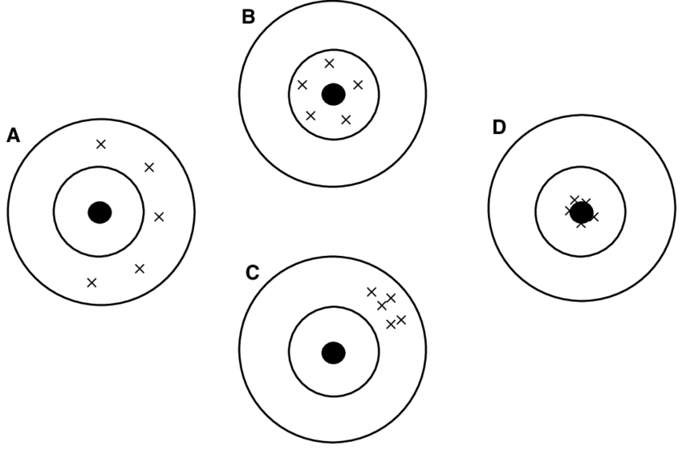

## Summary overview


<br>

::: {.columns}

::: {.column width="30%"}

<div style="text-align:center;">

Motivating

question  


<br>

<svg height="120" width="30" xmlns="http://www.w3.org/2000/svg">
  <defs>
    <marker id="arrowhead" markerWidth="10" markerHeight="7" 
            refX="5" refY="3.5" orient="auto">
      <polygon points="0 0, 10 3.5, 0 7" fill="black"/>
    </marker>
  </defs>
  <line x1="15" y1="0" x2="15" y2="100" 
        stroke="black" stroke-width="3" 
        marker-end="url(#arrowhead)"/>
</svg>


<br>

**Theory**

</div>

:::

::: {.column width="7.5%"}

<div style="text-align:center;">

<br>

<br>

<br>

<br>

<br>

<br>

⟶

</div>

:::

::: {.column width="25%"}

<div style="text-align:center;">

<br>

<br>

<br>

<br>

<br>

<br>

***Model***

</div>

:::

::: {.column width="7.5%"}

<div style="text-align:center;">

<br>

<br>

<br>

<br>

<br>

<br>


⟶

</div>

:::

::: {.column width="30%"}

<div style="text-align:center;">

Empirical

question  

<br>

<svg height="120" width="30" xmlns="http://www.w3.org/2000/svg">
  <defs>
    <marker id="arrowhead" markerWidth="10" markerHeight="7" 
            refX="5" refY="3.5" orient="auto">
      <polygon points="0 0, 10 3.5, 0 7" fill="black"/>
    </marker>
  </defs>
  <line x1="15" y1="0" x2="15" y2="100" 
        stroke="black" stroke-width="3" 
        marker-end="url(#arrowhead)"/>
</svg>
 

<br>

**<span class="fragment highlight-red">Hypothesis</span>**


</div>

:::

:::

::: {.notes}
**Time:** 14:15-14:18 (3 min). Session plan (90 min): lecture and interaction 14:15-15:08 (53 min) · student presentation and discussion 15:08-15:42 (at least 30 min) · wrap-up 15:42-15:45

- Recap of session 3 (same diagram as there): motivating question -> theory -> model -> empirical question -> hypothesis
- The highlighted box is where we left off: a hypothesis is a claim about *variables*, but our theories are about *concepts*
- Today: how we get from the concept to something we can observe and count (KW ch. 5, "Measuring Concepts of Interest", pp. 104-124)
- Seminar questions 4 (due Wednesday 07.10, 12:00) asked students to take their session 3 hypothesis and name its DV, IV and indicators; the group exercise later uses those answers
:::

---

## Concepts and hypotheses

. . .

<br>

Theoretical models put forward an expected relationship between **concepts**

However, these concepts are normally **abstract**, not directly observable in reality

<br>

. . .

E.g., ***Political sophistication***

*Definition:* how knowledgeable citizens are about politics

. . .

Do we observe it in reality ❓

::: {.notes}
**Time:** 14:18-14:22 (4 min)

- KW p. 104 (chapter overview): we care about causal relationships between *concepts*, but what we actually examine are statistical associations between *variables*
- KW p. 105: "we do not actually observe those concepts"; many are "inherently elusive" and hard to measure quantitatively
- Political sophistication is one of KW's "sticky" concepts (p. 110, citing Luskin 1987): how do we tell sophisticated from unsophisticated citizens, and whether a society's sophistication rises or falls over time?
- Ask: can you see sophistication? No: we see answers to quiz questions, education, news use... each is only a trace of the concept
- Other sticky concepts in KW (pp. 109-111): judicial activism, congressional liberalism, political legitimacy, social capital
- Wording follows session 3: theories and models relate concepts; hypotheses are about variables
:::

## Operationalization

. . .

<br>

It is the translation of **concepts** into **variables** (empirical indicators)

The goal is to turn our theory into **testable hypotheses** 

<br>

. . .

For that, we use **observational manifestations** of abstract concepts


- Sometimes straightforward: e.g., *income → salary ($)*  
- Sometimes not straightforward: e.g., *political sophistication → political knowledge survey questions*

::: {.notes}
**Time:** 14:22-14:27 (5 min)

- KW p. 105: operationalization = "the movement of variables from the rather abstract conceptual level to the very real measured level"; we can test hypotheses only after doing this for every variable
- KW p. 105: "For every theoretical concept, there are multiple operationalization or measurement strategies"
- One variable can combine several indicators: five quiz questions -> one political knowledge score; Polity's four components -> one democracy score (KW p. 117); several V-Dem coders' ratings -> one index (Little & Meng, applied reading)
- *Even income is not that easy* (KW 5.3.1, pp. 111-112): asked "What is your income?", a student with wealthy parents who never worked answers zero. Truthful, but not a valid measure of her economic position. Better: total household income in the last tax year, all sources
- KW p. 112: the best measure "depends on what our theoretical objectives are"; poverty example (pp. 107-108, 123): pre- vs. post-transfer income, depending on whether we study policy effectiveness or how being poor shapes attitudes
- Political knowledge items: e.g., "Who is the current president of the Swiss Confederation?", "How many members does the Federal Council have?"
- KW p. 105-106 practical advice: think about the ideal data first, then check what already exists; beginners "almost always underestimate the difficulties and the costs" of collecting their own data
:::

---

<br>

<div style="text-align:center;">


</div>

::: {.notes}
**Time:** 14:27-14:29 (2 min)

- KW Figure 1.2 (p. 9, "From theory to hypothesis"), already used in session 3
- Terminology: KW call both rows "variables" (concept vs. measured); we keep "variable" for what we can measure, as in KW's own definition (p. 3, fn. 1: "a definable quantity that can take on two or more values"). Top row = concepts, bottom row = variables
- Top row: the theoretical, conceptual level (causal theory between concepts)
- Bottom row: the empirical, measured level (hypothesis between variables)
- The vertical arrows are operationalization: today's topic. If they are weak, a test of the bottom row tells us little about the top row (KW 5.6, p. 122)
:::

## Assessing measurement

. . .

Two main *criteria*:

- **Reliability:** the extent to which a measure produces consistent results

- **Validity:** the extent to which a measure captures the concept it is supposed to

    - Face validity
    - Content validity
    - Construct validity

::: {.notes}
**Time:** 14:29-14:33 (4 min)

- KW 5.3 (p. 111) summarises measurement in three steps: (1) conceptual clarity, (2) a reasonable level of measurement, (3) a measure that is both valid and reliable; repeat for every variable
- *Reliability* (KW p. 112): applying the same measurement rules to the same case produces identical results
  - Bathroom scale: 150 lbs, step off, step on again, 146 lbs -> unreliable. But 157 lbs one week later is not unreliability; that is change over time (pp. 112-113)
  - Coding text with several coders: reliable coding rules give the same result whatever the coder (p. 113); intercoder agreement (see Barnes & Karim, session 5)
- *Validity* (KW p. 114): "The most important feature of a measure is that it is valid": it represents the concept it is supposed to measure. KW p. 114: there is "no simple formula" for validity; we rely on several overlapping checks:
  - *Face validity*: on its face, does the measure appear to measure what it claims? (KW pp. 114-115). The weakest check: a judgement call
  - *Content validity*: does the measure contain all the critical elements that define the concept, and exclude what is not part of it? (KW p. 115). Democracy needs elections, but elections alone are not enough (North Korea holds them)
  - *Construct validity*: is the measure related to other measures as theory requires? (KW p. 115). A democracy score that correlates with economic development, as modernization theory predicts
- Keep it short here: examples and KW's two controversies (Polity, political tolerance) come on the "Assessing validity" slide after the simulation
:::

## Reliable vs. valid measures

. . .

::: {.r-stack}

{width=70% fig-align="center"}

{.fragment width=70% fig-align="center"}

:::

. . .

[Valid ≈ no systematic error (low **bias**) · Reliable ≈ little random error (low **variance**)]{style="font-size:80%"}

::: {.notes}
**Time:** 14:33-14:39 (6 min)

- Classroom quiz: the bull's-eye is the concept, each cross one application of the measure. Ask the room, target by target: which is valid but not reliable, reliable but not valid, neither, both? Let students argue before the next click reveals the labels
- Answers: A neither (scattered and off-centre); B valid, not reliable (scattered around the centre); C reliable, not valid (tight cluster in the wrong place); D valid and reliable
- Follow-up: which target is a bathroom scale that always adds 5 kg? (C) One whose reading jumps by a few kilos every time you step on it? (B)
- Last click: the same distinction in statistical vocabulary, which the simulation and session 5 use. *Bias* = systematic distance from the centre (KW 5.3.3, p. 113: "the systematic over-reporting or under-reporting of values for a variable"); *variance* = random spread (random measurement error)
- KW 5.3.5 (pp. 115-116, Figure 5.1, shown again at the end): an unreliable measure makes it pointless to assess validity; a reliable but invalid measure is useless for testing causal theories; only reliable *and* valid measures are useful
:::

## More data: less noise, same bias

```{r}
#| fig-width: 11
#| fig-height: 5
#| fig-align: center

library(ggplot2)

# 300 measurements of a true value of 0: same random error, one with a constant bias of +1
set.seed(45)
n <- 300
sim <- data.frame(
  i = rep(seq_len(n), 2),
  type = factor(rep(c("Random error only", "Random error + systematic bias"), each = n),
                levels = c("Random error only", "Random error + systematic bias")),
  y = c(rnorm(n, mean = 0, sd = 2), rnorm(n, mean = 1, sd = 2))
)
sim$running_mean <- ave(sim$y, sim$type, FUN = function(x) cumsum(x) / seq_along(x))

ggplot(sim, aes(x = i)) +
  geom_point(aes(y = y), colour = "grey55", alpha = 0.35, size = 1.2) +
  geom_line(aes(y = running_mean, colour = type), linewidth = 1.3) +
  geom_hline(yintercept = 0, linetype = "dashed") +
  facet_wrap(~ type) +
  scale_colour_manual(values = c("#1f77b4", "#d62728"), guide = "none") +
  coord_cartesian(ylim = c(-5, 6)) +
  labs(x = "Number of measurements", y = "Measured value",
       caption = "Points: single measurements · Line: average of all measurements so far · Dashed: true value") +
  theme_minimal(base_size = 16)
```

::: {.notes}
**Time:** 14:39-14:43 (4 min)

- Simulated data: 300 measurements of a true value of 0. Both panels have the same random error (SD = 2); the right panel adds a constant bias of +1
- Grey points: single measurements, noisy in both panels. Coloured line: the running average of all measurements so far
- Left: the average wobbles at first and then settles on the true value; random errors cancel out
- Right: the average settles too, but on the wrong value (+1); more data makes us *precisely wrong*
- Message: a bigger sample buys precision (reliability of the estimate), not validity
- KW's surprising point (pp. 113-114): for theory testing, prefer a *biased but reliable* measure over an unbiased but unreliable one. If X is shifted upward for everyone, the pattern between X and Y stays visible; random noise in X obscures it
- Caveat that sets up the applied reading: this holds for bias that is constant. If the bias changes over time or across groups, it creates or hides patterns (Little & Meng: coder bias that may have grown over time)
- Link to session 5 (KKV 2.7): unbiasedness and consistency of estimators
:::

## Assessing validity

. . .

<div style="font-size:80%;">

- **Face validity**  

Does the indicator look like it measures the concept? (e.g., *I know it when I see it*)

- **Content validity**  

Does the indicator capture the full range of the concept?

- **Construct validity**  

Does the indicator behave as theory predicts it should, in relation to other variables?

</div>

::: {.notes}
**Time:** 14:43-14:50 (7 min). If behind schedule: skip the tolerance controversy, keep Polity

- Definitions: KW pp. 114-115 and the chapter glossary (p. 123)
- *Face validity*: on its face, does it measure what it claims? KW's Potter Stewart epigraph (p. 104): "I know it when I see it", the weakest check
- *Content validity*: does it contain all the critical elements of the concept, and exclude what is not it? Democracy needs elections, but North Korea holds elections too (p. 115)
- *Construct validity*: does it relate to other measures as theory requires? If theory links democracy and development, a democracy measure correlated with GDP validates both. Problem: if the correlation is absent, is the measure or the theory wrong? "There is no conclusive way to tell" (p. 115)

**KW's two controversies**

- *Democracy* (KW 5.4, pp. 116-120): Dahl (1971): contestation + participation. Polity IV (-10 to +10) has face validity: Brazil's scores track its coups and transitions (Fig. 5.2). But it measures only contestation, so it lacks content validity: the US scores 10 almost throughout (Fig. 5.3), although women got the vote only in 1920 and Jim Crow laws lasted a century after the Civil War
- *Political tolerance* (KW 5.5, pp. 120-122): Stouffer (1955) asked about civil liberties for communists, socialists, atheists; education predicted tolerance. Sullivan, Piereson & Marcus (1979): tolerance "presupposes opposition"; an atheist allowing atheists to teach is not tolerant. Asking about each respondent's *least-liked* group: intolerance much higher, and perceived threat, not education, was the main predictor
- Lesson (KW p. 122): measuring a concept differently can change substantive findings about causes and effects
:::

---

## Beyond reliability and validity...

. . .

<div style="text-align:center;">

{width=85%}
</div>

::: {.notes}
**Time:** 14:50-14:53 (3 min). If behind schedule: one sentence and move on

- Callback to session 3's applied reading: Turnbull-Dugarte & Wagner (2025), *Heroes and villains*, PSRM (presented by Alessio Gallonetto, Lea Hafen and Benjamin Seiwert)
- Concept: motivated political projection, which you cannot ask about directly ("Do you assume villains vote for the other party?")
- Their measure: a visual conjoint with forced choice, "Which character do you think is more likely to be a [Democratic/Republican] voter?" Coded 1 if the respondent projects their own party onto the character, 0 otherwise
- Validity work: a preliminary validation test (Prolific, US and UK) checked that the characters are actually seen as heroes or villains, i.e. that the valence manipulation measures what it should
- Point of the slide: good measurement is often creative and indirect; ask how a design gets at an unobservable concept, not only whether a measure is "valid"
:::

---

{fig-align="center"}

::: {.notes}
**Time:** 14:53 (transition)

- Transition to the pair exercise: this time two volunteers each (one pair presents)
:::

## Group exercise

. . .

<div style="font-size:80%">

Pair up and evaluate each other’s answers to the Session 3 and Session 4 questions.  

<br>

**1. Check your partner’s research question and hypothesis (Session 3):**  
- Can you identify the main argument of your partner’s theory? Is it correct?  
- Can you refine the research question and hypothesis to make them more consistent with the theory? 

<br>

**2. Check the empirical indicators your partner proposed (Session 4):**  
- Can you suggest better empirical indicators for the concepts?  
- Can you agree together on the best indicators?

</div>

::: {.notes}
**Time:** 14:53-15:05 (12 min: ~7 in pairs, ~5 for one or two pairs to report). Hard stop at 15:05; cut the reporting before cutting the presentation time

- Uses seminar questions 3 (due 30.09) and 4 (due Wednesday 07.10, 12:00); students swap their uploaded answers
- ~10 minutes in pairs, then 1-2 pairs report (previous slide: two volunteers)
- Seminar question 4 asked: (1) DV and IV of the hypothesis; (2) direction of the relationship; (3) are the variables concepts or indicators? If concepts, propose indicators; if indicators, name the concept
- What to listen for:
  - Hypotheses stated in concepts with no indicator ("democracy increases trust")
  - Indicators that miss part of the concept (content validity: e.g., trust in government measured only by turnout)
  - Survey items that invite social desirability (KW's prejudice question, p. 114)
  - Can the same indicator be measured reliably by someone else? (coding rules, question wording)
- Students who missed session 3 can work from their seminar question 4 answers alone
:::

# Conclusion


---

<div style="text-align:center;">

{width=75%}

</div>

::: {.notes}
**Time:** 15:05-15:07 (2 min)

- KW Figure 5.1 (p. 116), "Reliability, validity, and hypothesis testing": is the measure reliable? If not, stop. If yes, is it valid? Only reliable and valid measures are useful for evaluating causal theories
- KW 5.7 (pp. 122-123): measurement "cannot take place in a theoretical vacuum"; the theoretical purpose decides how we measure
- Next up: a paper that applies exactly this lens to a measure everybody uses (democracy indices)
:::

## Up next: applied reading

<br>

Presentation by **Nuraida Abdykapar Kyzy, Simon Ferdinand Eibach and Martins Titilola**:

- Little, A. T., & Meng, A. (2023). Measuring democratic backsliding. *PS: Political Science & Politics*

::: {.notes}
**Time:** 15:07-15:08 hand over; presentation 15:08-15:33 (25 min max.), discussion 15:33-15:42

- Presenters: Nuraida Abdykapar Kyzy, Simon Ferdinand Eibach, Martins Titilola (three presenters: second slot, short preparation time)
- Slides were due Wednesday 07.10, 12:00 in Students responses/Presentation slides; check they are there
- Grade with 00_grading/presentation_grading_sheet.pdf: clarity, understanding, critique quality, reasoning, feasibility, discussion (0-5 each; 15/30 = pass)
- Timing: 25 minutes max., then discussion to improve the proposal
- Citation: online first 2023 (as in the syllabus); print version PS 57(2), April 2024, pp. 149-161

**The paper, in today's terms**

- Claim (p. 149): the narrative of global democratic decline rests mostly on *subjective*, expert-coded indicators (V-Dem, Freedom House); *objective* indicators show little decline over the past decade
- Objective vs. subjective (p. 151): litmus test = would multiple qualified experts with the same information reach the same conclusion? Objective = reliable in KW's sense (e.g., winner's vote share, suffrage share); subjective = "election free and fair?" (0-4)
- Reliability evidence (p. 151): V-Dem coders disagree; average SD across coders 20-25% of the scale, almost 1 point on a 0-4 scale
- Bias: V-Dem's measurement model corrects for harsh vs. lenient coders, but assumes coder standards are constant over time (p. 152). Time-varying bias is exactly the case where KW's "bias is less of a problem" does not hold
- Findings (pp. 152-157): incumbent parties lose elections no less often (Fig. 2); winners' vote and seat shares fall; competitiveness indices rise; no more term-limit evasions
- Two explanations (pp. 157-158): time-varying coder bias (more media coverage, US-based experts' concerns) vs. leaders shifting to subtle backsliding that only experts can detect; they argue coder bias explains at least part of the gap
- Discussion hooks: content validity (are elections and turnover all of democracy?); is "objective" really unbiased (incumbents can lose for performance reasons, p. 158)? Unweighted country averages vs. population weights (p. 151)
:::

## Next session (08.10.26 - 16:15, room 4.B51)

<br>

***Descriptive inference*** · Basic reading: KW, ch. 6 (pp. 125–141)

. . .

<br>

Presentation by **Rika Elena Hünerbach and Samantha Irving**:
Barnes & Karim (2025), *The Manosphere and politics*

::: {.notes}
**Time:** 15:42-15:43 (1 min)

- Same day: session 5, 16:15-18:00, room 4.B51 (syllabus schedule)
- Basic reading: KW (Kellstedt & Whitten), ch. 6, "Getting to Know Your Data", pp. 125-141; additional: KKV ch. 2, Gerring (2012), de Kadt & Grzymala-Busse (2025)
- Presenters: Rika Elena Hünerbach and Samantha Irving; Barnes & Karim (2025), *Comparative Political Studies*
- Seminar questions 5 were due Wednesday 07.10, 12:00, together with today's
:::

---

{fig-align="center"}

::: {.notes}
**Time:** 15:43-15:44 (1 min)

- Open floor: questions on measurement, validity and reliability, or the presentation
:::

## Haven't chosen your R track yet?

{fig-align="center"}

::: {.notes}
**Time:** 15:44-15:45 (1 min)

- Some students still have not reported their R track (beginner or advanced); check 00_admin/track_choices.csv before class for the current count (do not name anyone in class)
- Use the track self-check from session 1 (8 statements, 0-2 each; 0-9 beginner, 10-16 advanced) and email the choice to the lecturer
- The track decides which set of take-home exercises a student gets (syllabus): exercise I is published in OLAT on 15.10 (session 7), due 29.10
:::

## Thanks! :slightly_smiling_face:

<br>

<br>

<br>

<center>[klueser@ipz.uzh.ch](mailto:klueser@ipz.uzh.ch)</center>

::: {.notes}
**Time:** 15:45 end; break until session 5 at 16:15

- Contact: klueser@ipz.uzh.ch; meetings via Zoom on request within a week (syllabus: no fixed office hours)
:::


