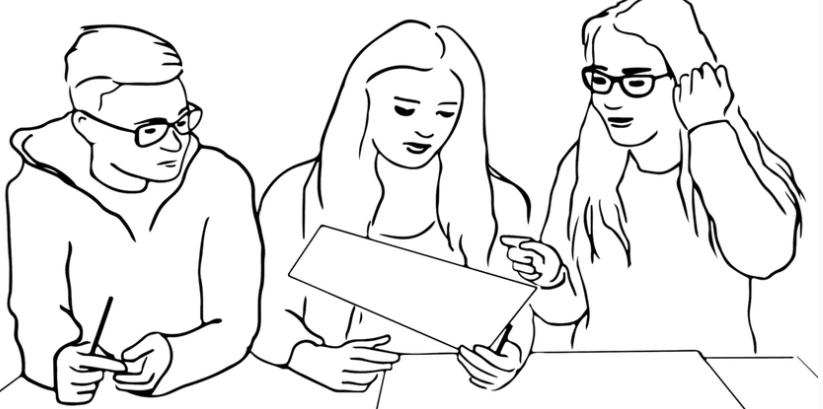

## Back to attendance

Last week: students who **attend more** get **better grades**

But motivated students attend more *and* study more

. . .

<br>

✋ What if we **flipped a coin** to decide who has to attend?

. . .

- Would you **trust** the result?
- Would it be **allowed**?

::: {.notes}
**Time:** 14:15-14:20 (5 min). Session plan (90 min): lecture and interaction 14:15-15:07 (52 min) · student presentation and discussion 15:08-15:42 (at least 30 min) · wrap-up 15:42-15:45

- Picks up session 6: the hypothetical attendance finding and the four patterns (confounding, reverse causation, selection, chance)
- Ask first: would you trust a coin-flip comparison more than last week's comparison? Why? Expected: the coin does not care how motivated you are
- Then: would it be allowed? Expected: forcing some students to stay away is unfair or unethical; nobody can force students to come, so some "attenders" will skip anyway (comes back at 14:49 as noncompliance)
- Write two lists on the board: "why the coin helps" and "why we can't just do it". Both come back at the end (14:49)
- Today: why randomization solves the selection problem, and where it stops working
:::

## Are insured people healthier?

```{=html}
<table style="font-size:75%; margin:auto;">
<thead><tr><th></th><th style="text-align:right;">Insured</th><th style="text-align:right;">Uninsured</th><th style="text-align:right;">Difference</th></tr></thead>
<tbody>
<tr><td>Health (1 = poor, 5 = excellent)</td><td style="text-align:right;">4.01</td><td style="text-align:right;">3.70</td><td style="text-align:right;"><b>0.31</b></td></tr>
<tr class="fragment"><td>Years of education</td><td style="text-align:right;">14.3</td><td style="text-align:right;">11.6</td><td style="text-align:right;">2.7</td></tr>
<tr class="fragment"><td>Employed</td><td style="text-align:right;">92%</td><td style="text-align:right;">85%</td><td style="text-align:right;">7 pts</td></tr>
<tr class="fragment"><td>Family income (USD)</td><td style="text-align:right;">106,467</td><td style="text-align:right;">45,656</td><td style="text-align:right;">60,810</td></tr>
</tbody>
</table>
```

[Married men, US National Health Interview Survey 2009 (AJ, Table 1.1)]{style="font-size:60%; color:gray;"}

✋ Does health insurance make people **healthier**?

::: {.notes}
**Time:** 14:20-14:25 (5 min)

- AJ pp. 3-5, Table 1.1 (husbands; wives look the same: health gap .39). Health index from "Would you say your health in general is excellent, very good, good, fair, or poor?", 5 = excellent, 1 = poor (AJ p. 3). A gap of .31 is large: the standard deviation is about 1 (AJ p. 4)
- Show only the first row and ask the question. Let students answer yes first, then reveal the other rows one at a time
- Ask after each row: what does this tell you? The insured are better educated, more often employed and earn more than twice as much
- AJ's phrase: comparing the two groups is "apples to oranges, or worse" (p. 4)
- Link to session 6: this is confounding, and the attendance problem in another setting
:::

## Selection bias in words

**Difference in group means** = **average causal effect** + [**selection bias**]{style="color:red"}

::: {.incremental}
- We need the insured's health **without** insurance, but never see it [(session 6)]{style="color:gray"}
- So the **uninsured** stand in. But they are poorer and less educated
- [**Selection bias**]{style="color:red"}: how much healthier the insured would be **anyway**
:::

. . .

✋ In the NHIS: is the selection bias **positive** or **negative**?

::: {.notes}
**Time:** 14:25-14:29 (4 min)

- AJ eq. 1.3, p. 10: "Difference in group means = Average causal effect + Selection bias", with the words written under the formula in the book
- Formal version (only if asked): E[Yi | Di = 1] − E[Yi | Di = 0] = κ + (E[Y0i | Di = 1] − E[Y0i | Di = 0]), where κ is the constant causal effect and Y0i the health of person i without insurance (AJ pp. 9-10)
- Terminology: AJ says "average causal effect"; the seminar questions and session 6 say average treatment effect (ATE). Same thing
- AJ's two-person example (pp. 6-8, Table 1.2): Khuzdar is insured, health 4, would be 3 without (effect +1); Maria is uninsured, health 5 either way. Naive comparison: 4 − 5 = −1, although insurance helps Khuzdar. Use it if students struggle with the idea of selection bias
- Answer to the question: positive. Richer, better-educated people would be healthier even without insurance, so the naive comparison overstates the effect of insurance
- Selection bias is the session 6 counterfactual problem: we never see Y0 for the insured
:::

## Just randomize

<br>

**RAND Health Insurance Experiment** (US, 1974–1982)

. . .

- 3,958 people **randomly assigned** to one of 14 insurance plans
- From **free care** to **catastrophic coverage** (pay about 95% yourself)

. . .

<br>

✋ Why should a **lottery** fix the problem we just saw?

::: {.notes}
**Time:** 14:29-14:32 (3 min)

- AJ pp. 16-18: 3,958 people aged 14 to 61 from six US areas; 14 plans grouped into catastrophic, deductible, coinsurance and free care. Catastrophic plans approximate no insurance
- AJ section heading: "Breaking the deadlock: just RANDomize" (p. 12)
- Answer: the lottery does not know how rich, educated or healthy you are. So the groups should be the same in everything except the plan, including how healthy they would have been without insurance (AJ p. 15: random assignment eliminates selection bias)
- "Should be": let's test that in this room
:::

## Let's randomize this room

**Treatment:** born on an **even** day of the month

**Control:** born on an **odd** day

. . .

<br>

✋ Hands up in each group if you...

- commuted **more than 30 minutes** today
- have **at least one sibling**
- had **coffee** today

. . .

Are the two groups **alike**?

::: {.notes}
**Time:** 14:32-14:40 (8 min)

- Birthday day is as good as random for our purposes: it is unrelated to commuting, siblings or coffee
- Ask the two groups to sit on different sides of the room, or just ask each group to raise hands in turn. Count hands per group and write the shares on the board (e.g., 4 of 11 vs. 5 of 13)
- Expected: the shares are close but not identical. Ask: is a difference of one or two people a problem? Where does it come from? (chance)
- Then: take only two students, one from each group. Are those two alike? Clearly not: that is the next slides
- If a group is very unbalanced, even better: that is chance in a small sample (session 6, pattern 4)
:::

## Checking for balance

```{=html}
<table style="font-size:70%; margin:auto;">
<thead><tr><th>Before the experiment</th><th style="text-align:right;">Catastrophic</th><th style="text-align:right;">Free care</th><th style="text-align:right;">Difference</th></tr></thead>
<tbody>
<tr><td>Female</td><td style="text-align:right;">56%</td><td style="text-align:right;">52%</td><td style="text-align:right;">−3.8 pts</td></tr>
<tr><td>Age</td><td style="text-align:right;">32.4</td><td style="text-align:right;">32.8</td><td style="text-align:right;">0.4</td></tr>
<tr><td>Years of education</td><td style="text-align:right;">12.1</td><td style="text-align:right;">11.8</td><td style="text-align:right;">−0.3</td></tr>
<tr><td>Family income (USD)</td><td style="text-align:right;">31,603</td><td style="text-align:right;">30,627</td><td style="text-align:right;">−976</td></tr>
<tr><td>General health index</td><td style="text-align:right;">70.9</td><td style="text-align:right;">69.6</td><td style="text-align:right;">−1.3</td></tr>
</tbody>
</table>
```

[RAND Health Insurance Experiment (AJ, Table 1.3)]{style="font-size:60%; color:gray;"}

. . .

Remember the NHIS income gap: **60,810 USD**

::: {.notes}
**Time:** 14:40-14:43 (3 min)

- AJ pp. 16-20, Table 1.3, columns 1 and 4 (catastrophic plan means; free minus catastrophic). The free-care means are computed as catastrophic + difference
- Checking for balance (AJ p. 16): compare characteristics measured *before* treatment. Randomization should make them similar; if they are not, something went wrong with the lottery, or chance was unkind
- Compare with the room: same logic, larger groups (catastrophic 759, free care 1,295 people)
- Only one difference here is larger than chance would usually produce: share female (−.038, SE .015, AJ p. 19). AJ's point: a few differences are expected by chance; there is no consistent pattern (the free group has slightly lower cholesterol but a slightly lower health index)
- AJ (p. 30, Grasshopper): even in randomized trials we check for balance
:::

## Why size matters

Flip a coin for **two** people: one gets insurance, one doesn't

→ any difference could be **who** they are, not the insurance

. . .

<br>

With **thousands** of people, the group averages get **closer and closer**

→ **law of large numbers**

. . .

<br>

✋ Our room has about 24 people. How **close** were our two groups?

::: {.notes}
**Time:** 14:43-14:46 (3 min)

- AJ pp. 12-13: a coin toss for two people (Ashish and Zandile) does not make them comparable; randomization works through the law of large numbers
- Law of large numbers in words (AJ p. 13): the average in a large sample is close to the average in the population it came from. Two random halves of a large sample therefore have nearly the same averages, for every characteristic, measured or not
- Formal version only if asked: the sample mean converges in probability to the population mean
- Back to the room: our groups were roughly alike but not exactly; RAND had about 4,000 people, NHIS more than 9,000 per sex. Large samples alone do not help (NHIS is huge and still biased): you need size *and* random assignment
:::

## What RAND found

```{=html}
<table style="font-size:70%; margin:auto;">
<thead><tr><th>After 3–5 years</th><th style="text-align:right;">Catastrophic</th><th style="text-align:right;">Free care</th><th style="text-align:right;">Difference</th></tr></thead>
<tbody>
<tr><td>Doctor visits per year</td><td style="text-align:right;">2.8</td><td style="text-align:right;">4.4</td><td style="text-align:right;"><b>+1.7</b></td></tr>
<tr><td>Total health expenses (USD)</td><td style="text-align:right;">636</td><td style="text-align:right;">921</td><td style="text-align:right;"><b>+285</b></td></tr>
<tr class="fragment" data-fragment-index="1"><td>General health index</td><td style="text-align:right;">68.5</td><td style="text-align:right;">67.7</td><td style="text-align:right;">−0.8</td></tr>
<tr class="fragment" data-fragment-index="1"><td>Mental health index</td><td style="text-align:right;">75.5</td><td style="text-align:right;">75.9</td><td style="text-align:right;">+0.4</td></tr>
</tbody>
</table>
```

[RAND Health Insurance Experiment (AJ, Table 1.4)]{style="font-size:60%; color:gray;"}

✋ Free care: more doctor visits. **Healthier**?

::: {.notes}
**Time:** 14:46-14:49 (3 min)

- AJ pp. 20-23, Table 1.4, columns 1 and 4. Health outcomes mostly measured 3 or 5 years after random assignment (AJ p. 22)
- Show only the first two rows and ask: what do you expect for health? Then reveal
- Free care raised use and spending (outpatient spending up by about two thirds, total by 45%) but did not make people measurably healthier: no health difference is statistically significant (AJ p. 22)
- Compare with the NHIS: the naive comparison suggested a large health gap; the experiment finds none. The NHIS gap was mostly selection bias
- If asked about significance and standard errors: AJ's chapter appendix (pp. 33-46); not part of today's reading
:::

## What experiments can't do

Back to the coin flip for attendance: **why can't we just do it?**

. . .

- **Ethics**: you can't keep students away from class, or deny people care
- **Can't be randomized**: age, gender, democracy, war
- **Cost**: RAND ran for 8 years with almost 4,000 people
- **People don't comply**: in Oregon's insurance lottery, winning ≠ being insured
- **External validity**: does a US study from the 1970s tell us about Switzerland today?

::: {.notes}
**Time:** 14:49-14:55 (6 min)

- Start from the board list from 14:15 ("why we can't just do it"), then reveal and match
- Ethics and feasibility: some treatments can't be assigned at all (age, gender, regime type), others shouldn't be (attendance, health care)
- Noncompliance, one line only: AJ section 1.2, "The Oregon Trail" (pp. 24-29). In 2008 Oregon held a lottery for Medicaid places: about 75,000 registered, about 30,000 were invited to apply. Winning raised insurance coverage by only 26 percentage points (AJ Table 1.5, p. 26), because many winners never signed up. Comparing winners and losers measures the effect of *winning*, not of *being insured* (AJ ch. 3 handles this). The applied reading has the same problem
- External validity: RAND sampled people aged 14 to 61 in six US areas in the 1970s; the Swiss health system works differently
- Back to attendance: what could we randomize instead? E.g., reminder emails, or which sessions are recorded. That changes the question: the effect of a reminder, not of attendance
- Bridge to session 9: when we cannot randomize, we need observational data and must deal with selection bias in other ways
:::

## Group exercise

<br>

In **pairs**, using your seminar questions:

1️⃣ Check your partner's **treatment** and **control** groups: without randomization, would comparing them give the **ATE**?

2️⃣ Check your partner's **confounders**: are they convincing? Can you add one?

3️⃣ Could your partner **actually randomize** the treatment? If not, why not?

{width=22% fig-align="center"}

::: {.notes}
**Time:** 14:55-15:05 (6 min in pairs, 4 min plenary)

- Builds on seminar questions 8.1 (treatment group, control group, outcome, ATE) and 8.2 (two confounders); prompt 3 applies the previous slide
- Plenary (4 min): seminar question 8.3, "would randomization solve the selection bias problem completely?" Expected: in expectation yes, in a large sample; not if the sample is small (chance), people don't comply, or people drop out. And it says nothing about whether the result travels
- One or two pairs: whose treatment can't be randomized, and why? Keep the answers; session 9 starts from there
- If behind: skip the plenary and take 8.3 into session 9
:::

## Can you randomize a protest?

. . .

<br>

No. But you can randomize **who walks past one**

. . .

<br>

✋ What would be the **treatment**, the **control** and the **outcome**?

::: {.notes}
**Time:** 15:05-15:07 (2 min)

- Lead-in to the applied reading; do not give away the design, the presenters will explain it
- Haas et al.: field experiment in Berlin during three Fridays for Future climate strikes (2023-2024), N = 261 paid participants. An app randomly assigned them to walk a route of about 2.6 km either past the strike (treatment) or in the opposite direction (control). Outcomes: norm perceptions, attitudes, vote intentions, and behaviour (donations from their payment, newsletter sign-ups)
- Take two or three guesses, then hand over
:::

## Up next: applied reading

<br>

Presentation by **Chantal Hüsler and Nina Franziska Jäggi**:

- Haas, V. I., Wappenhans, T., Geißler, F., Hartmann, F., Bischof, D., Giesecke, J., & Humphreys, M. (2024). Beyond Persuasion: Protest's Direct Behavioral Impact on Bystanders. *Working paper*

::: {.notes}
**Time:** 15:07-15:08 hand over; presentation 15:08-15:33 (25 min max.), discussion 15:33-15:42

- Presenters: Chantal Hüsler and Nina Franziska Jäggi
- Slides were due Wednesday 21.10, 12:00 in Students responses/Presentation slides; check they are there
- Grade with 00_grading/presentations/session08/session08_handwritten.pdf: clarity, understanding, critique quality, reasoning, feasibility, discussion (0-5 each; 15/30 = pass)
- Timing: 25 minutes max., then discussion to improve the proposal
- The PDF students got is the version of 19 June 2025 (the file name still has the older title "Does protest affect bystanders?")
- Results: no detectable effects on norms, attitudes or Green vote intention; donations to Fridays for Future rose by about 4.45 EUR (SE 1.51), donations to other causes and newsletter sign-ups did not. The authors call it "behavioral activation" rather than persuasion
- Discussion hooks:
  - Noncompliance: not everyone on the treatment route noticed the strike (manipulation checks vary by wave), so the authors estimate the effect of actual exposure, with the assigned route as an instrument. Same gap as Oregon: assigned vs. treated
  - External validity: paid recruits on an assigned walk are not ordinary passers-by; Fridays for Future in Berlin as a "most likely case"; strikes of very different size across waves
  - Attrition: only about half came back for the follow-up after 26 days
  - Demand effects: the cover task (counting park benches) and the donation menu with three causes; does it work?
:::

## Next session (22.10.26 - 16:00, room 4.B51)

<br>

***Large-N observational studies***

Basic reading: AJ, ch. 2 (pp. 47–81)

. . .

<br>

Presentation by **Ibrahima Khalil Ndiaye and Ella Schertenleib**:
Ziblatt, Hilbig & Bischof (2024), *Wealth of tongues*

::: {.notes}
**Time:** 15:42-15:43 (1 min)

- Same day: session 9, 16:00-17:45 (from today, the second session starts 15 minutes earlier), same room 4.B51
- Basic reading: AJ, ch. 2 "Regression", pp. 47-81; additional: KW pp. 92-99; Cinelli, Forney & Pearl (2024), *A crash course in good and bad controls*
- Presenters: Ibrahima Khalil Ndiaye and Ella Schertenleib; Ziblatt, Hilbig & Bischof (2024), *Wealth of tongues: Why peripheral regions vote for the radical right in Germany*, APSR
- Take-home exercise II is published in OLAT in session 9 (deadline 05.11.26); take-home exercise I is due 29.10.26
:::

---

{fig-align="center"}

::: {.notes}
**Time:** 15:43-15:45 (2 min)

- Open floor: questions on experiments, the take-home exercise, or the presentation
:::

## Thanks! :slightly_smiling_face:

<br>

<br>

<br>

<center>[klueser@ipz.uzh.ch](mailto:klueser@ipz.uzh.ch)</center>

::: {.notes}
**Time:** 15:45 end; break until session 9 at 16:00

- Contact: klueser@ipz.uzh.ch; meetings via Zoom on request
- Backup slide follows (lab, survey or field?); use it if there is time, or in the discussion of the applied reading
:::

## Backup: lab, survey or field?

Experiments differ in **where** and **how real** they are

. . .

- **Lab**: participants come to the researcher
- **Survey**: random variation inside a questionnaire [(session 7's LLM paper)]{style="color:gray"}
- **Field**: real people, real treatments, real settings [(RAND; today's paper)]{style="color:gray"}

. . .

<br>

✋ How "field" is a **paid** walk past a protest?

::: {.notes}
**Time:** optional, about 3 min

- GG ch. 1, section 1.4 (pp. 8-13): "fieldness" has four dimensions: how authentic the treatment, the participants, the context and the outcome measure are. Most studies are field-like on some and not on others
- Trade-offs (GG pp. 13-17): field experiments are less obtrusive and can measure long-run outcomes, but are harder to run, depend on partners, and must be argued to be ethical
- Naturally occurring randomizations count as experiments (draft lottery, Oregon lottery); designs that rely on argument rather than randomization (e.g., close elections) do not
- Haas et al.: real protest and real donations (field), but paid recruits on an assigned route (less field)
:::
